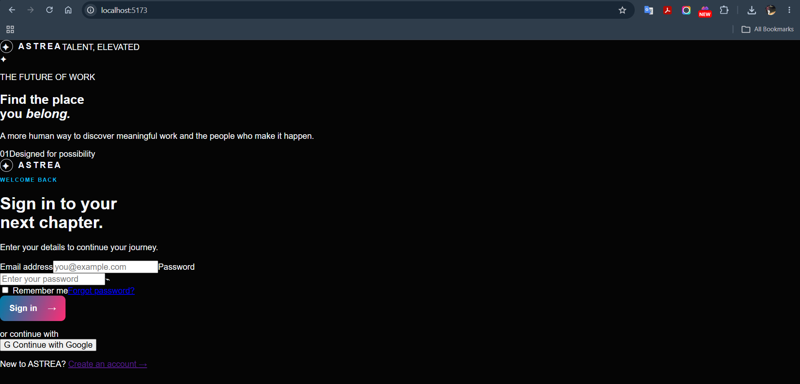
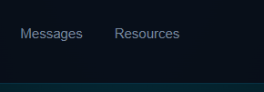
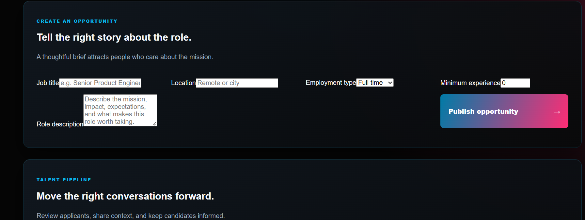

# HireFlow AI

AI-powered recruitment and applicant tracking platform connecting candidates, recruiters, companies, jobs, applications, interviews, and explainable AI assistance.

## Project status

Days 1–7 are complete for the local-development scope. Day 7 adds responsive UI polish, health/readiness checks, security defaults, structured logging, CI, Docker healthchecks, repeatable demo data, and release documentation.

Managed cloud deployment remains outside this local project scope.

## Technology stack

- React, TypeScript, Vite, React Router, Axios, TanStack Query
- Django and Django REST Framework
- FastAPI for AI workloads
- PostgreSQL in production
- Redis and Celery for asynchronous processing
- Django Channels for real-time events
- Docker Compose is optional for team/deployment environments.

## Repository guide

- `backend/`: Django modular monolith
- `ai-service/`: FastAPI AI boundary
- `frontend/`: React application
- `infrastructure/`: Docker, Nginx, and operational scripts
- `docs/`: architecture, setup, daily records, tests, and walkthroughs

## Product preview

The current UI includes separate experiences for authentication, candidates, and recruiters.

| Login | Candidate portal | Recruiter portal |
|---|---|---|
|  |  |  |

## Quick start

Docker is not required for Day 1. Start Django, FastAPI, and React separately; development settings use SQLite when PostgreSQL is not configured. Detailed commands are in [`docs/Walk Through/`](docs/Walk%20Through/) and [`docs/development-setup.md`](docs/development-setup.md).

## Verification

Backend: `python manage.py check` and `python manage.py test apps.accounts.tests -v 1`.

AI service: `python -m pytest -q` from `ai-service`.

Frontend: run `npm test`, `npm run build`, and `npm run test:e2e` from `frontend` after installing Chromium with `npx playwright install chromium`.

The browser suite covers authentication, candidate profile, resources, messages, interviews, and password-reset navigation. It can be run with:

```powershell
cd frontend
npm install
npx playwright install chromium
npm test -- --run
npm run build
npm run test:e2e
```

Docker Compose configuration can be checked locally with:

```powershell
docker compose config
docker compose up --build -d
docker compose ps
docker compose down
```

Docker is optional for local development and is not required to run the frontend, Django backend, or AI service separately.

## Documentation

Start with [`docs/README.md`](docs/README.md), then review [`docs/architecture.md`](docs/architecture.md), [`docs/authentication.md`](docs/authentication.md), and the daily workflow records.
